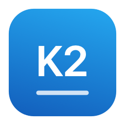
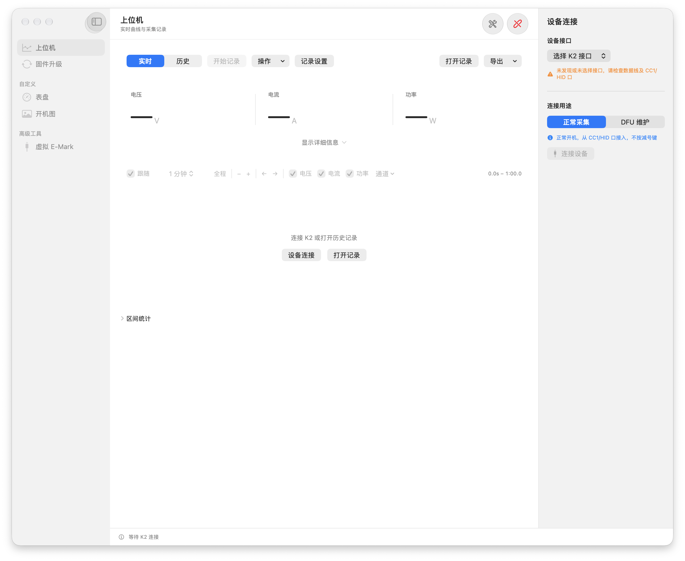
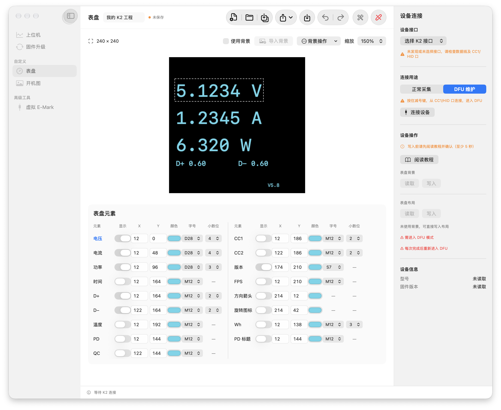
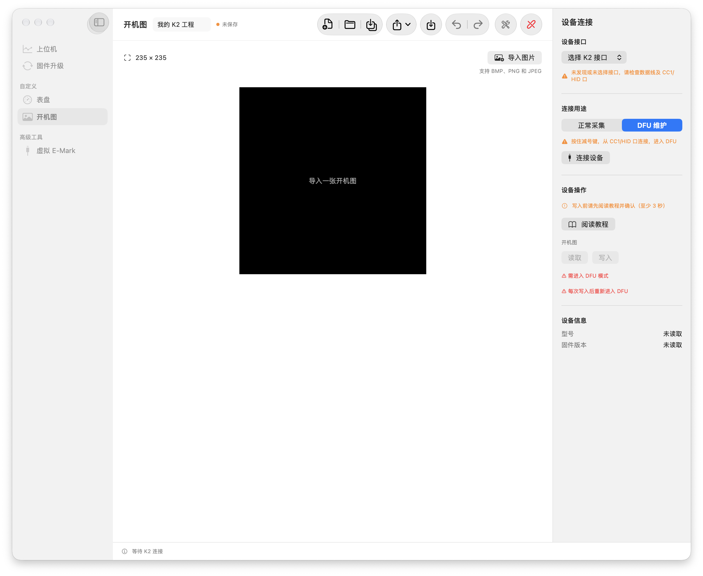
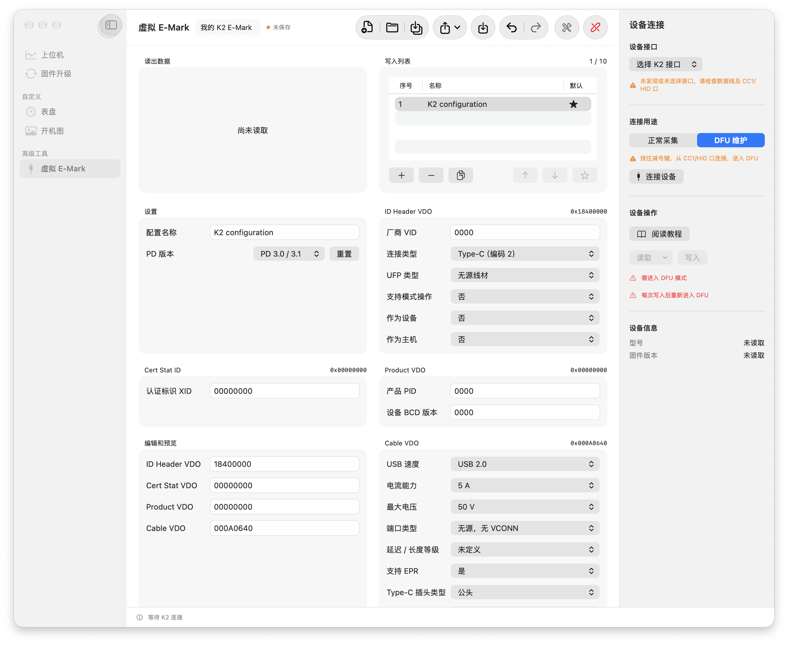

<p align="center">
  
</p>
<h1 align="center">维简 Mac · WITRN K2</h1>
<p align="center">在 Mac 上看曲线、做记录，也把 K2 调成自己喜欢的样子。</p>
<p align="center">
  
  
  <a href="LICENSE"></a>
</p>
<p align="center">
  <a href="docs/quick-start.md">开始使用</a> ·
  <a href="docs/macos-app.md">完整指南</a> ·
  <a href="CHANGELOG.md">更新日志</a> ·
  <a href="https://github.com/lliooly/WITRN-K2-REVERSE">协议与逆向研究</a>
</p>

一款面向 **维简 WITRN K2** 的原生 SwiftUI 工具箱，将日常测量和设备维护放在同一个窗口：实时曲线与本地记录、固件升级、表盘编辑、开机图和虚拟 E-Mark。未连接设备时，也能整理工程、编辑资源和查看历史记录。

本项目是独立社区软件，与 WITRN 无隶属关系，未获厂商认可或赞助。当前打包版本为 **0.7.1**；构建目标为 macOS 13+，Apple Silicon / Intel 双架构。最低系统和 Intel 实机的验证情况见下方说明。



## 一个窗口，五种用途

| 页面 | 可以做什么 |
| --- | --- |
| **上位机** | 查看电压、电流、功率、温度与 D± 曲线；SQLite 长时间记录；暂停、继续、自动停止；区间统计；CSV / SQLite 交换和 PNG 曲线导出 |
| **固件升级** | 四步向导、自动检测接口、检查官网固件或选择本地 `.k2`、升级前双遍备份、写后读回校验和任务日志 |
| **表盘** | 编辑 17 项布局元素，调整坐标、颜色、字号和精度；拖动预览；官方 `.pic` 导入导出；保存 `.k2project` 工程 |
| **开机图** | 导入 BMP / PNG / JPEG，裁剪、缩放、留边或拉伸；转换为设备图像并单独备份与写入 |
| **虚拟 E-Mark** | 管理最多 10 组自定义配置、默认组和排序；官方 `.wtemark` 交换；高级 VDO 编辑与 `.k2emark` 工程 |

<details>
<summary><strong>看看资源编辑界面</strong></summary>

### 表盘



### 开机图



### 虚拟 E-Mark



</details>

## 开始使用

目前以**源码构建**为可靠入口。预编译包是否可用，以 [Releases](https://github.com/lliooly/witrn-k2-mac/releases) 中实际上传的附件为准；仓库不附带厂商固件。应用只做 ad-hoc 本地签名，尚未使用 Developer ID 签名或公证。

需要 Xcode 26 或更新版本（含 macOS 26+ SDK）、Python 3.9 和打包依赖。Universal 2 构建要求 Python 及其标准库扩展支持两个架构；Apple Silicon 上验证 Intel 后台还需要 Rosetta。环境细节见[构建说明](docs/macos-app.md#本地构建)。

```sh
git clone https://github.com/lliooly/witrn-k2-mac.git
cd witrn-k2-mac
python3.9 -m venv .venv-app
.venv-app/bin/python -m pip install -r requirements-app.txt
./script/build_and_run.sh --build-only
open 'dist/K2 Updater.app'
```

首次连接、文件格式和常见问题见[快速开始](docs/quick-start.md)。应用显示名为「维简 Mac」；构建产物路径、可执行文件名和数据目录沿用原名，以兼容现有脚本和本地资料。

## 连接与写入前先了解这些

- **看曲线：** K2 正常开机，用支持数据传输的 USB 线连接 CC1/HID 口，选择接口后连接。
- **维护设备：** 按教程进入 DFU，再检测设备身份。设备维护和实时采集不能同时占用接口。
- **擦写保护：** 图形版写入前先双遍读取并持久化备份：固件升级备份完整 Flash，资源写入备份涉及的完整扇区；资源写入保留同扇区其他数据，随后校验整个擦除范围。固件正文读回一致后才提交并退出。
- **失败处理：** 失败即停止，不自动重试。擦写之后拔线、断电或强制退出可能使应用区不完整；保留备份并重新检查 DFU 状态。

备份与日志位于 `~/Library/Application Support/K2 Updater/`，请自行保存副本。项目不收集上传这些文件；分享问题前请移除序列号、个人路径和原始通信数据。虚拟 E-Mark 参数不会提高实体线材的电气承载能力。

### 已验证与待验证

| 能力 | 当前证据与边界 |
| --- | --- |
| 固件升级 | 曾在一台 K2 上完成 3.4 → 5.8 并完整读回；不代表其他型号或版本兼容 |
| 实时采集与文件交换 | K2 5.8 普通模式采集、暂停 / 继续、自动停止和三种记录格式往返已验证 |
| 开机图 | 已实机写入并校验完整扇区，重新上电显示正常 |
| 表盘背景 / 布局、E-Mark、恢复刷写 | 有离线测试和模拟覆盖，完整实机效果或恢复流程仍待验证 |
| Intel / macOS 13 | 为构建目标；双架构包可检查，Intel USB 与 macOS 13 实机仍待验证 |

更详细的依据见[应用验证范围](docs/macos-app.md#验证范围)与[遥测实机记录](docs/k2-monitor-hardware-validation.md)。离线测试通过不等于实机兼容。

## 命令行与开发

Python CLI 可独立进行固件检查、离线预演、设备探测和备份。离线操作不需要 USB 或 HIDAPI：

```sh
python3 k2_updater.py inspect /path/to/K2_APP.k2
python3 k2_updater.py dry-run /path/to/K2_APP.k2
python3 -m unittest discover -s tests -v
```

连接设备时先安装 `requirements.txt`。真实刷写会擦除设备应用区，CLI 命令及确认选项见[命令行指南](docs/cli.md)。

| 路径 | 职责 |
| --- | --- |
| `macos/` | SwiftUI 应用、Swift 核心模型与测试 |
| `k2up/` | Python 后台、HID 协议、记录存储与 CLI |
| `script/` | 构建、打包、离线验证与文档检查 |
| `tests/` | 合成样本与模拟器回归 |
| `docs/` | 使用、兼容性、发布和实现说明 |
| `reverse/` | 应用开发所保留的分析脚本和证据 |

请先阅读[贡献指南](CONTRIBUTING.md)。改动前后运行 Python 与 Swift 检查；完整命令见指南。离线 CI 检查代码与文档，不接触 USB，也不自动发布安装包。

## 与 reverse 仓库配合

[WITRN-K2-REVERSE](https://github.com/lliooly/WITRN-K2-REVERSE) 整理 HID / DFU、文件格式、研究证据、JSON 进程接口与 Python 函数契约；本仓库负责可使用的 Mac 应用和后台集成。协议说明与实现通过链接和人工复核对齐，**不是自动同步的共享 SDK**。

- 使用应用：从这里开始。
- 自行开发上位机或核对命令：查看 reverse 的[接口入口](https://github.com/lliooly/WITRN-K2-REVERSE/blob/main/api/README.md)。
- 修改跨仓库协议：按[联动约定](docs/repository-map.md)记录来源、提交版本与验证边界。

## 贡献、致谢与许可

感谢所有参与开发、测试、研究和问题反馈的人。[贡献者与致谢](CONTRIBUTORS.md)列出维护者、贡献记录和上游来源；欢迎从文档、复现步骤和脱敏的兼容性反馈开始参与。

原创代码与文档采用 [MIT License](LICENSE)。第三方图片、依赖和协议数据的适用范围见 [NOTICE](NOTICE.md) 和[第三方说明](third_party/README.md)；第三方 DFU 插图适用其原有 GPL-3.0 许可。项目许可不授予厂商软件、固件或商标权利。
